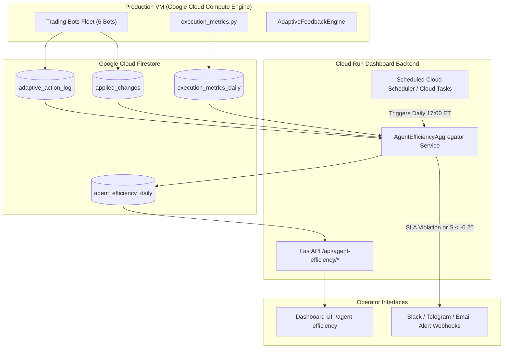

# Agent Efficiency Measurement & Regular Monitoring Specification

**Document:** `AGENT_EFFICIENCY_MONITORING.md`  
**Repository:** `tradingbot-dashboard`  
**Status:** 🚀 Active Implementation (PR [#153](https://github.com/PowerStreamCoder/tradingbot-dashboard/pull/153))  
**Target Milestone:** v5.7.0  
**Related Issue:** [#139](https://github.com/PowerStreamCoder/tradingbot-dashboard/issues/139)  
**Scope:** Multi-Agent Autonomous Algorithmic Engine (`AgentOrchestrator`, `AdaptiveEntryAgent`, `AdaptivePnLAgent`, `AdaptiveCoveredCallAgent`, `AdaptiveFeedbackEngine`, `LearningEngine`, `TradeLogAuditor`)

---

## 1. Executive Summary & Motivation

The `TradingBots` ecosystem utilizes a multi-tiered autonomous agent architecture comprising 7 specialized agents. While each agent autonomously adapts strategy parameters (entry thresholds, in-flight profit/stop locks, covered-call strikes, and nightly proposal generation), observability into whether these agents are **net-accretive to alpha** versus **detrimental to performance** is currently fragmented across raw Firestore logs (`adaptive_action_log`, `applied_changes`) and nanosecond execution metrics (`cascade_phase_*_ns`).

### Core Problem:
1. **Lack of Centralized Agent Scorecard**: Operators cannot inspect at a glance whether an agent's interventions (e.g. moving a stop to break-even or delaying an entry) resulted in net profit or premature stop-outs.
2. **Absence of Regular Health & Drift Monitoring**: Parameter nudges occur autonomously under a $\pm 35\%$ clamp, but there is no automated daily/weekly digest summarizing agent performance trends, drift velocity, or circuit-breaker events.
3. **Unmonitored Latency Contention**: In-loop agents evaluate real-time ticks within the exit cascade. Latency spikes in one agent can degrade downstream order execution without raising an immediate alert on the dashboard.

### Objective:
Build an end-to-end **Agent Efficiency Measurement and Regular Monitoring Subsystem** within `tradingbot-dashboard`, providing:
- Real-time quantitative efficiency metrics for all 7 agents across all active symbols (`NVDA`, `IWM`, `MSFT`, `CAT`, `QQQ`, `AFRM`).
- Dedicated Dashboard View (`/agent-efficiency`) and REST APIs.
- Regular automated health and efficiency digests (daily post-close digest + weekly governance review).
- SLA and latency threshold monitoring with proactive degradation alerts.

---

## 2. Multi-Agent Measurement Framework & KPIs

Efficiency is evaluated across two core dimensions:
1. **Financial & Alpha Efficiency ($\text{Eff}_{\text{financial}}$)**: Did the agent's decisions generate positive R-multiples, preserve capital, or reduce drawdowns compared to an unmanaged baseline?
2. **Computational Runtime Efficiency ($\text{Eff}_{\text{runtime}}$)**: Did the agent execute within strict SLA time boundaries ($p99 \le 500\text{ ms}$) without inducing event-loop contention?

### Agent-by-Agent Metrics Matrix

| Agent | Primary Efficiency Metrics | Mathematical Definition / Formula | Data Source |
|:---|:---|:---|:---|
| **`AgentOrchestrator`** | Strategy Intent Alignment, Exit Conflict Resolution, Dead Rule Elimination | • Intent-to-Regime Match Rate (%) • Shadowed Rule Ratio: $\frac{\text{Shadowed Exits}}{\text{Total Evaluations}}$ • Conflict Arbitration Frequency | `ExitTelemetry`, Firestore `bot_overview` |
| **`AdaptiveEntryAgent`** | Filter Selectivity, Admitted Setup Win Rate, False Breakout Avoidance | • Selectivity: $\frac{\text{Rejected Candidates}}{\text{Total Signals}}$ • Admitted Win Rate (%) & Profit Factor • Pre-Queue Block Attribution (`entry_blocked_mtf_blocked`, etc.) | `entry_telemetry.py`, `trade_history` |
| **`AdaptivePnLAgent`** | R-Multiple Retention, Giveback Shield Efficiency, Break-Even Conversion Rate | • Realized R-Multiple ($\bar{R}$) • Peak Giveback Saved ($): $\text{Peak Unrealized} - \text{Realized PnL}$ • Break-Even Conversion: $\frac{\text{Trades Closed Green}}{\text{Break-Even Locks Activated}}$ | `adaptive_action_log`, `trades` |
| **`AdaptiveCoveredCallAgent`** | Net Option Yield Capture, IV/HV Ratio Efficiency, Opportunity Cost Delta | • Premium Harvested vs Stock Upside Capped ($) • IV/HV Capture Ratio: $\frac{\text{Realized Option Premium}}{\text{Implied Volatility Target}}$ • Assignment Avoidance Success Rate (%) | `options_manager.py`, Firestore `trades` |
| **`AdaptiveFeedbackEngine`** | Rolling Effectiveness Score ($S$), Nudge Win Rate, Circuit Breaker Rate | • Rolling Score: $S = \frac{1}{N}\sum_{i=1}^N S_i$ ($N \in [5, 20]$) • Helped / Hurt Action Ratio • PF Circuit Breaker Trips ($\Delta \text{PF} < -0.15$) | `applied_changes`, `adaptive_action_log` |
| **`LearningEngine`** | Proposal Acceptance Rate, Expected vs Realized $\Delta \text{Sharpe}$, Defect Elimination | • Candidate Adoption Rate (%) • Backtest-Predicted $\Delta\text{Sharpe}$ vs Realized $\Delta\text{Sharpe}$ • Recurring Anomaly Reduction Velocity | `learning_candidates`, `governance_proposals` |
| **`TradeLogAuditor`** | 14-Check Integrity Score, Anomaly Detection Rate, Live PF Score | • 14-Check Pass Rate (%) • Anomaly Severity Score • Live Recommendation Score ($+1$ gain / $-2$ rollback) | `audit_findings`, `audit_runs` |

---

## 3. Computational Runtime & SLA Monitoring

In-loop agents execute directly within the core trading loop. Their execution latency must be monitored continuously to guarantee strategy responsiveness:

### Execution SLAs:
* **Cascade Phase Duration ($p99$)**: $\le 500\text{ ms}$
* **Cascade Phase Max Duration**: $\le 2{,}000\text{ ms}$
* **Agent Evaluation Interval**: $\le 50\text{ ms}$ per tick callback

### Metrics Captured from `execution_metrics.py`:
- `cascade_phase_adaptive_ns`: Nanoseconds spent in `AdaptivePnLAgent` evaluation.
- `cascade_phase_marks_ns`: Price mark calculation and distance-to-barrier checks.
- `cascade_phase_orders_ns`: Order formulation and execution worker dispatch.
- **Proximity Throttling State**: Percent of ticks where expensive agent evaluations were bypassed because price was outside activation bands.

---

## 4. Regular Monitoring & Automated Alerting Architecture

To avoid manual log audits, the system will execute automated recurring monitoring pipelines:

### Regular Monitoring Schedule:
1. **Intraday Continuous (1-minute intervals)**:
   - Evaluates active SLA breaches ($p99 > 500\text{ ms}$ or event-loop stalls).
   - Surfaces real-time warnings on the dashboard header status pills.
2. **Post-Market Daily Digest (17:00 ET / 23:00 CET)**:
   - Aggregates the session's agent actions across all 6 symbols.
   - Calculates daily $S$-scores, R-multiples gained/saved, and parameter nudges applied.
   - Dispatches a concise summary digest to the notification channel.
3. **Weekly Governance & Parameter Drift Audit (Fridays 18:00 ET)**:
   - Audits cumulative parameter drift against the $\pm 35\%$ baseline safety threshold.
   - Flags agents that are stagnant (zero actions over 14 days) or hyperactive ($> 5$ nudges in a week).
   - Verifies whether accepted Learning Engine proposals yielded positive out-of-sample Sharpe deltas.

### Proactive Alert Triggers:
- 🚨 **Sustained Negative Alpha**: Agent rolling effectiveness score $S < -0.20$ across $\ge 2$ consecutive windows.
- 🚨 **Circuit-Breaker Tripped**: Level 0 Profit Factor rollback triggered ($\Delta\text{PF} < -0.15$).
- 🚨 **Latency SLA Breach**: Cascade phase $p99 > 500\text{ ms}$ or single execution $> 2{,}000\text{ ms}$.
- 🚨 **Parameter Pinning**: An adaptive parameter reaches its absolute safety clamp boundary (`THRESHOLD_CLAMPS`).

---

## 5. Dashboard Implementation Specification

### A. New UI View: `/agent-efficiency`
A new first-class navigation tab in `tradingbot-dashboard` with:
1. **Fleet Agent Health Overview**:
   - Status cards for all 7 agents showing operational health (Healthy, Degraded, Stalled, Paused).
   - Aggregate Alpha Impact: Net R-multiples contributed, premium harvested, giveback saved.
2. **Interactive Agent Deep-Dive Selector**:
   - Filter by Symbol (`NVDA`, `IWM`, `MSFT`, `CAT`, `QQQ`, `AFRM`, or `All Bots`).
   - Filter by Agent (`AdaptivePnL`, `AdaptiveEntry`, `CoveredCall`, etc.).
3. **Visual Charts**:
   - **Rolling Effectiveness Chart**: Plot of $S_t$ over time with shaded zones ($S > +0.40$ Helping, $-0.20 \le S \le +0.40$ Neutral, $S < -0.20$ Hurting).
   - **Parameter Drift Trajectory**: Historical line chart showing baseline value, live nudged value, and $\pm 35\%$ clamp limits.
   - **Cascade Phase Latency Distribution**: Box-and-whisker / bar chart of $p50, p95, p99$ timing per agent phase.
4. **Action Audit Table**:
   - Filterable table displaying individual actions, trigger conditions, post-exit resolved P&L, and assigned effectiveness score.

### B. REST API Endpoints (`main.py`):
- `GET /api/agent-efficiency/summary`  
  Returns high-level scorecard, health status, and key performance metrics across all 7 agents.
- `GET /api/agent-efficiency/bot/{symbol}`  
  Returns granular breakdown of agent actions, parameter states, and scores for a specific symbol.
- `GET /api/agent-efficiency/history?agent={agent}&window={days}`  
  Returns time-series telemetry for rendering rolling effectiveness and latency charts.
- `GET /api/agent-efficiency/alerts`  
  Returns recent SLA violations, circuit breaker rollbacks, and parameter clamp events.

---

## 6. Implementation Phases & Acceptance Criteria

### Phase 1: Data Model & Aggregator Service (`services/agent_efficiency_service.py`)
- [x] Implement query logic to aggregate `adaptive_action_log`, `applied_changes`, and `execution_metrics`.
- [x] Compute rolling $S$-scores, R-multiple retention, and circuit breaker trip metrics.
- [x] Add unit tests with hermetic Firestore mocks (`tests/test_agent_efficiency_service.py`).

### Phase 2: Backend API Endpoints (`main.py`)
- [x] Create `/api/agent-efficiency/summary`, `/api/agent-efficiency/bot/{symbol}`, and historical time-series endpoints.
- [x] Add error handling and response caching (60s TTL).
- [x] Validate response schemas with pydantic models.
- [x] Wire `/agent-efficiency` route and dashboard navigation header links across all templates.

### Phase 3: Dashboard UI & Visualizations
- [x] Create `templates/agent_efficiency.html` and `static/js/agent_efficiency.js`.
- [x] Style consistent with glassmorphic dark design system (`static/css/agent_efficiency.css`).
- [x] Implement Chart.js charts for rolling effectiveness ($S$) and parameter drift.

### Phase 4: Scheduled Monitoring & Alerting
- [x] Create notification & digest formatter service (`services/agent_efficiency_notifier.py`).
- [x] Implement daily 17:00 ET session aggregation scheduler trigger endpoint (`POST /api/agent-efficiency/daily-digest`).
- [x] Wire alerts into notification webhook router (`services/agent_efficiency_notifier.py`).
- [x] Add SLA latency violation detector.

---

*Authored for the TradingBots Ecosystem Architecture Group.*
